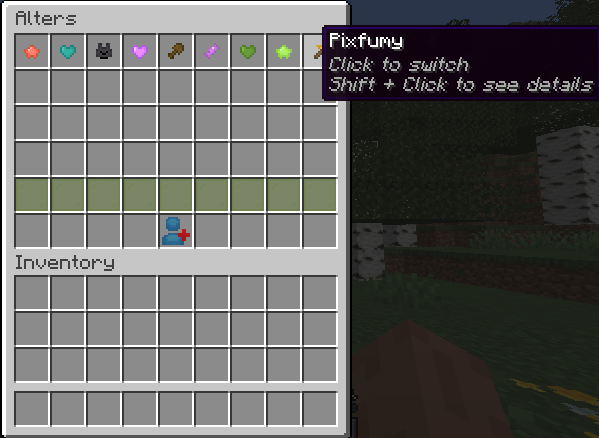
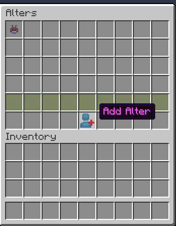
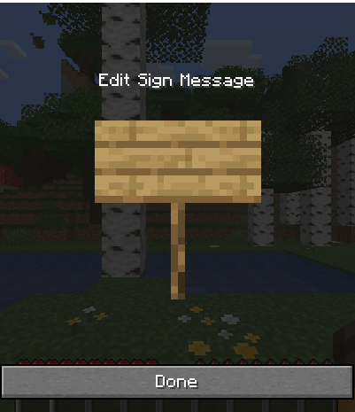
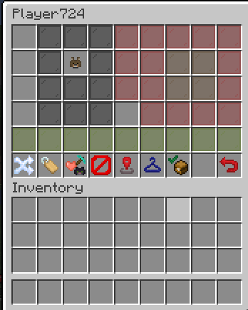
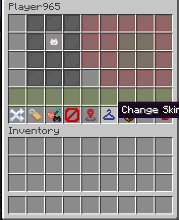
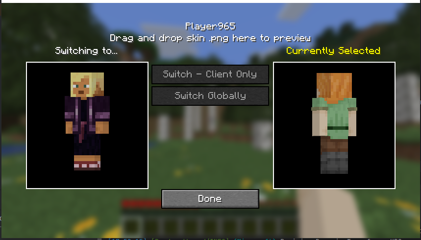

# Plurify

## Overview
This mod is intended for use by plural systems.

The mod enables you to have separate player profiles for each member of your system within the same Minecraft world ; and to be able to switch seamlessly between them.

Each player profile has its own:

- Name
- Health bar
- Hunger bar
- XP levels
- Inventory and Ender Chest
- Keep inventory toggle
- Location in the world
- (Optional) skin

## Usage

### Setup 
If on single player, add the mod to your fabric mods folder. Fabric API is not required, as the mod bundles whatever
Fabric API libraries that it needs.

On multiplayer servers, the mod only needs to be loaded server-side for all players to use, but it is recommended
that all players also have it loaded client side. The client-side mod enables the skin-changer and the 
Plurify hotkey.

### In-Game
Use the command `/alters` or press the Plurify hotkey (by default K) to see your system. The hotkey can be changed in 
**Options > Controls > Keybind > Plurify > Open Alters Menu**

If this is the first time this screen is being accessed, you will by default have a single alter
with your Minecraft username.

Click the Add icon to add a new alter.

You will now be prompted for an Alter name, enter it into the sign and press Done.

Shift + Click an alter to see their details:

Here you can change your alter's name, skin, icon, keep inventory toggle, and see their last location.

### Skin Changer

The client-side mod enables swapping skins between alters dynamically:

Drag and drop an ordinary 64x64 skin file here to preview the skin. Once you are happy with it, 
you are given two options:

- Switch - Client Only: Update the skin on your client only, visible to you. The mod will save the skin file to your .minecraft and remember each alter's skin next time you log on.
- Switch Globally: Update the skin on Mojang servers so that other players can see your skin. If you are logged into a server, this will trigger a reconnection to reset your skin texture.
