# Plurify
By [snuffypuffs](https://linktr.ee/snuffypuffs) and pixfumy 
## Overview

This mod is intended for use by plural folks, but can be loaded onto servers shared by
non-plural folks. The mod enables you to have separate player profiles for each member of your system within the same Minecraft world ; and to be able to switch seamlessly between them.

Each player profile has its own:

- Name
- Location in the world
- Health bar
- Hunger bar
- XP levels
- Inventory and Ender Chest
- Status Effects
- Advancements
- Stats
- Attributes
- Pets
- Trial Chamber Vaults (can loot once per member)
- Keep inventory toggle
- Skin (must have the mod loaded on your client)

The mod is made to be almost entirely server-side and to interfere as little as possible with the Vanilla experience
for those who  don't wish to interact with the mod.

## Mod Setup
### Singleplayer
In singleplayer, simply add the mod to your fabric mods folder. Fabric API is not required, as the mod bundles whatever
Fabric API libraries that it needs.

### Multiplayer
On multiplayer servers, the mod only needs to be loaded server-side for all players to use, but it is recommended
that all players also have it loaded client side. The client-side mod enables the skin-changer and the 
Plurify hotkey. 

It's also **highly** recommended to have [Polymer](https://modrinth.com/mod/polymer) on your server
in order to automatically generate the mod's custom resource pack (icons, translations).

Per the Polymer documentation: 
> Enabling AutoHost
> 
> For basic server setup (direct server without proxies, reusing port, 0.7.1+1.20.4 or newer)
>
> Start the server at least once. Then open the config file in config/polymer/auto-host.json and change the value in field "enabled" from false to true. Then save the file and restart the server! It should automatically apply the resource pack after it finishes generation.

## In-Game
Use the command `/alters` or press the Plurify hotkey (by default K) to see your system. The hotkey can be changed in 
**Options > Controls > Keybind > Plurify > Open Alters Menu**

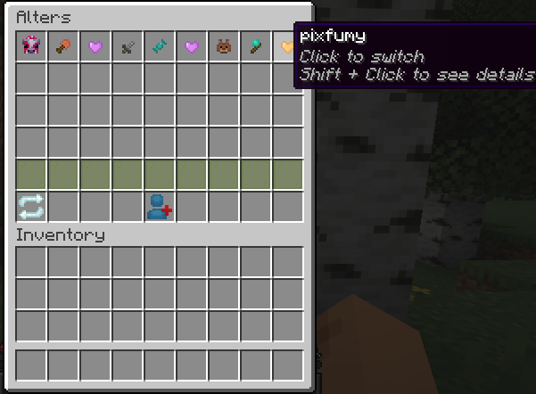

If this is the first time this screen is being accessed, you will by default have a single alter
with your Minecraft username.

## Creating your System

### From PluralKit
If you wish to import your system from PluralKit, click
on the "Import/Export System" icon:

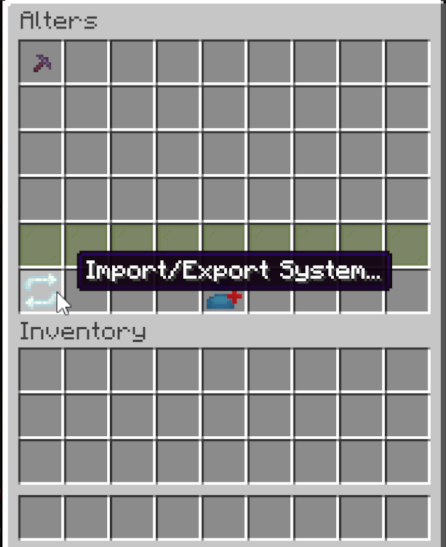

Now click on "Import System from PluralKit"

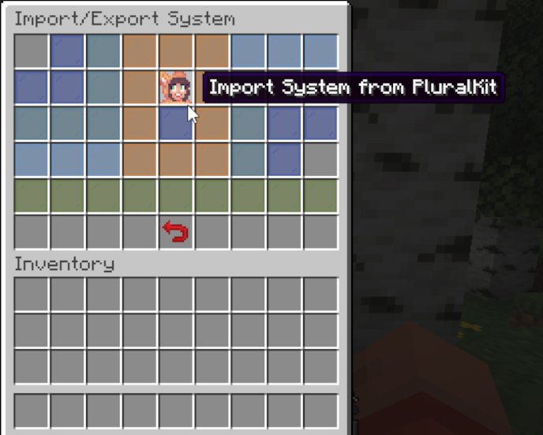

You will be prompted for your System ID, you can get this by
running the command `pk;system id` in Discord. Enter this
as the top line of the sign and press Done.

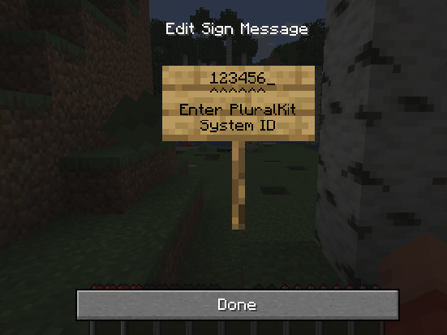

You should now see your alters in the menu:
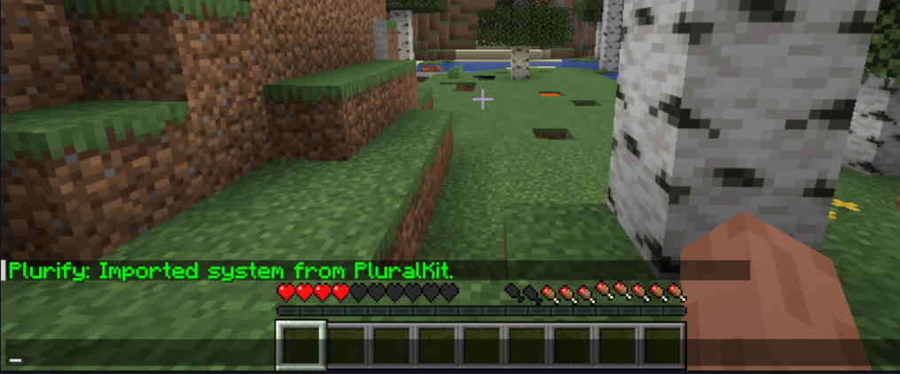
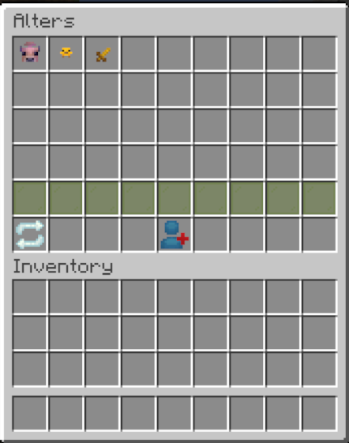

Note, the mod will do its best to combine your PluralKit system into your 
existing Minecraft system. Any existing alters that exist
only on your Minecraft will be preserved, but you may end up
with duplicates if you've created them in both Minecraft and PluralKit.

### Creating your System Manually
Click the Add icon to add a new alter.

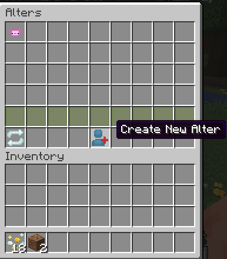

You will now be prompted for an Alter name, enter it into the sign and press Done.

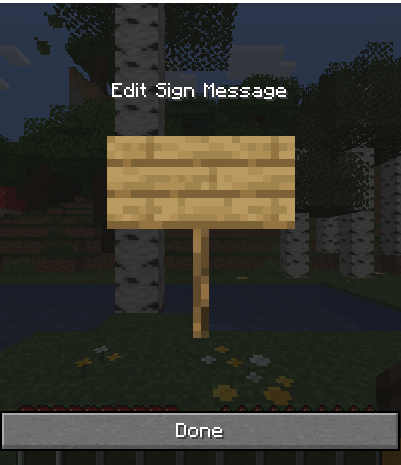

### Syncing your System between Singleplayer and Multiplayer

This mod is mostly server-side, meaning a copy of your system
will exist in your singleplayer files and a separate copy will exist
in any servers you play on that have the mod loaded.

If you're logged into a multiplayer server that has Plurify loaded, navigate to the Sync Screen we saw earlier, 

Here you'll see two additional options to upload your system from Singleplayer:

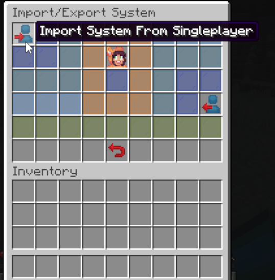

Or vice-versa, you can download your system from a
Multiplayer server to your Singleplayer files.

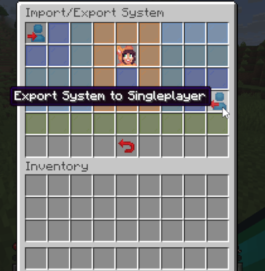

When doing this, the mod will do its best to combine the two
systems together. Any alters that exist in one system but not
the other will be preserved. Again, you may end up with
duplicates if you've created an Alter on both singleplayer
and multiplayer separately.

## Managing your Alters

Shift + Click an alter to see their details:

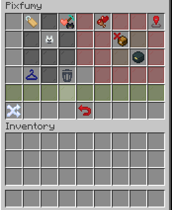

Here you can see/edit the following for a specific Alter:

- Inventory, Armour, Offhand slot (view only)
- Location in the world (view only)
- Health and Hunger (view only)
- Ender Chest Inventory (view only)
- Alter Icon (view + edit)
- Alter Name (view + edit)
- Keep Inventory toggle for this Alter, overrides the global gamerule keep_inventory (view + edit)
- Delete this Alter
- Alter Skin (view + edit, see below)

## Skin Changer

The client-side mod enables swapping skins between alters dynamically:

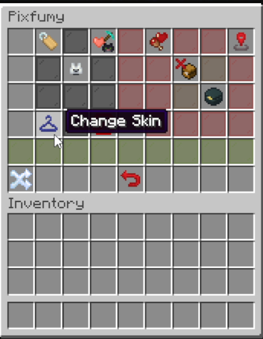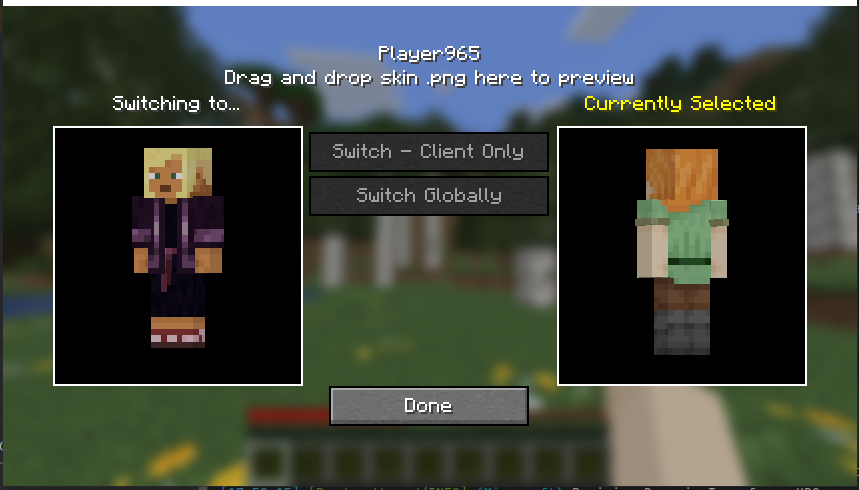

Drag and drop an ordinary 64x64 skin file here to preview the skin. Once you are happy with it, 
you are given two options:

- **Switch - Client Only**: Update the skin on your client only, visible to you. The mod will save the skin file to your .minecraft folder and remember each alter's skin next time you log on.
- **Switch Globally**: Update the skin on Mojang servers so that other players can see your skin. If you are logged into a server, this will trigger a reconnection to reset your skin texture.

**Note**, you won't need to drag/drop your skin each time you switch
alters. If you prefer you can switch globally after switching to an alter.

Note that each global switch will show up
on your skin history, and it can get very cluttered very quickly 
if you're viewing it through tools like NameMC, if you care about that kind of thing.

## Compatibilities

This mod works with other mods/datapacks that add custom advancements.

This is not true for stats/attributes/status effects, as those things aren't yet data-driven,
so they'd need to be implemented in Plurify on a per-mod basis.

This mod should never have a game-crashing incompatibility with other mods - if you find something of this
sort, let me know!

## Acknowledgments

- [snuffy](https://linktr.ee/snuffypuffs), of course, for coming up with the idea for this mod, and for making these pretty custom textures. Read their comics!!
- [Patbox](https://pb4.eu/), author of the SGUI library and Polymer, both of which this mod would not be possible without.
